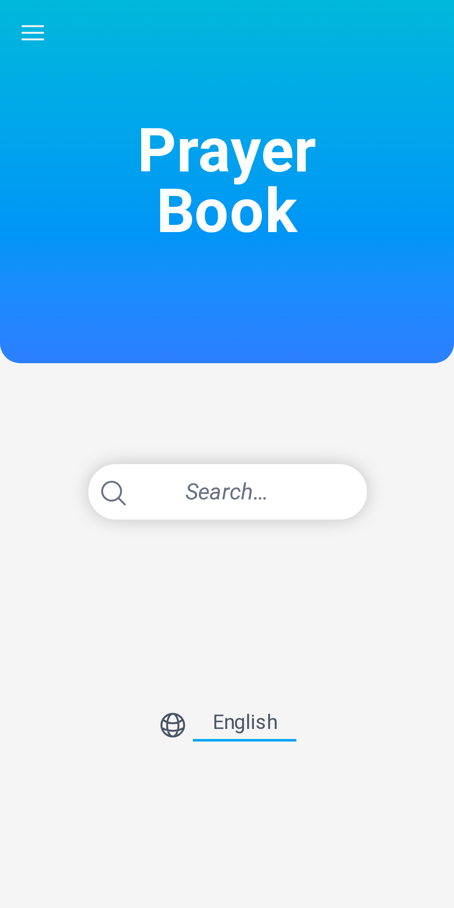
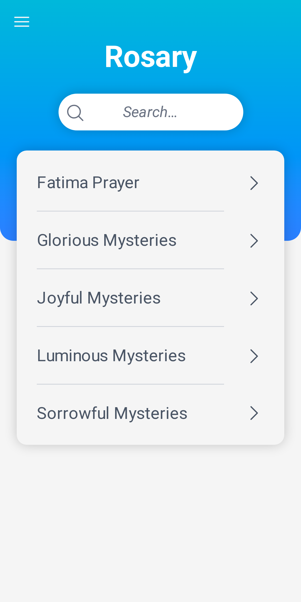
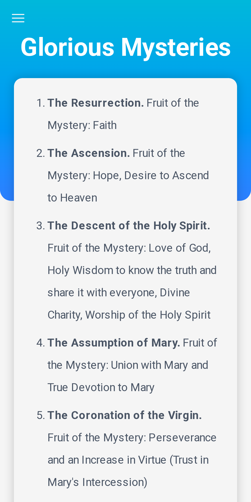
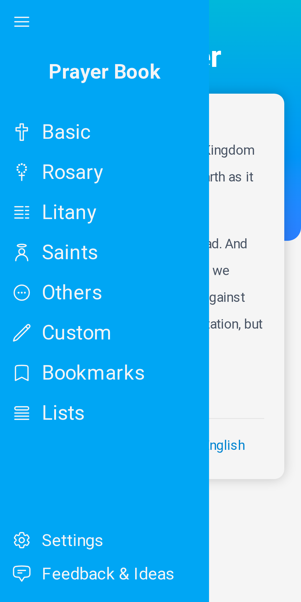
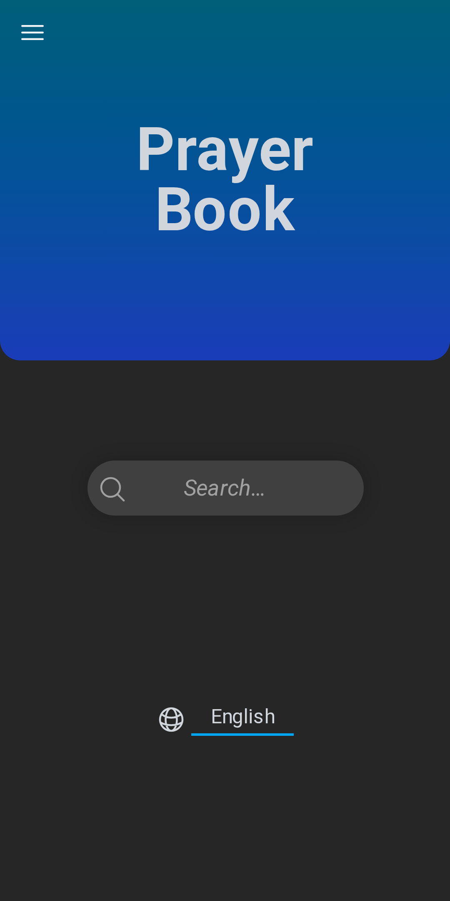
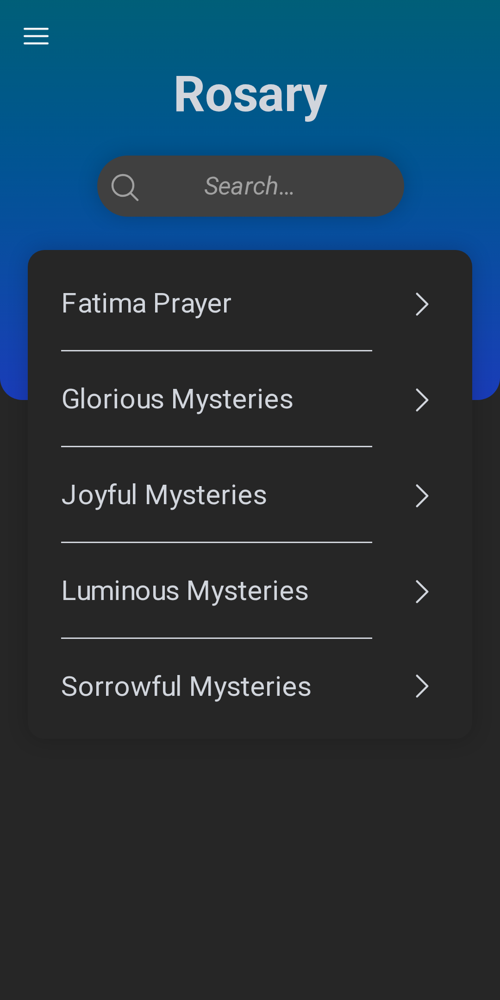
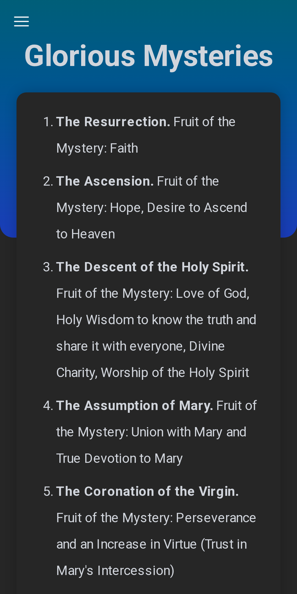
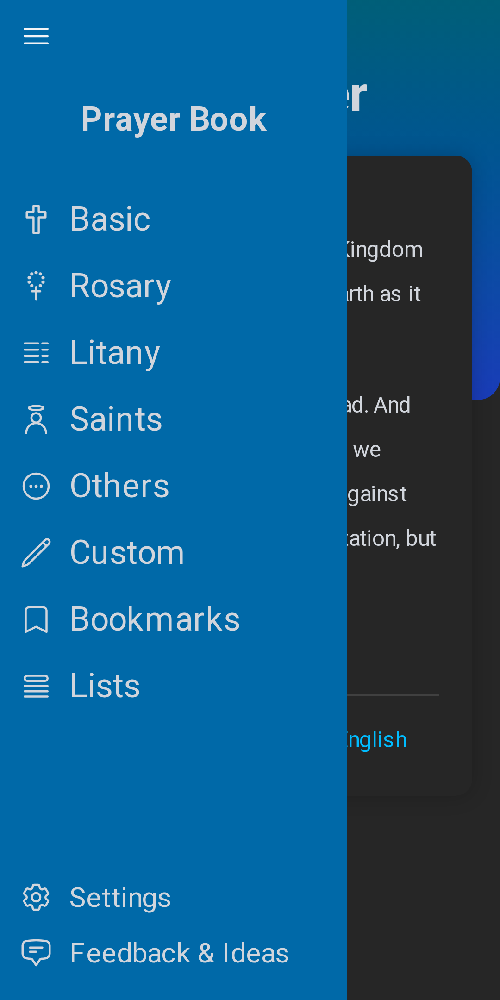

# Prayer Book

[](https://matrix.to/#/#prayer-book:matrix.org)

Mobile app with Catholic prayers.

[](https://f-droid.org/packages/io.jozo.prayerbook/)
[](https://play.google.com/store/apps/details?id=io.jozo.prayerbook)

Or download the latest APK from the [Releases Section](https://codeberg.org/jozo/prayer-book/releases/latest).

<p>
  
  
  
  
</p>

<p>
  
  
  
  
</p>

## Add prayers
Create a new file in the `src/prayers/{LANG}` directory with the following format:

```toml
title = "Prayer Title"
categories = ["basic"]  # one or more of: basic, rosary, litany, saints, other

[[versions]]
name = "Traditional version"
content = """
Prayer text in **markdown** format
"""

[[versions]]
name = "Modern version"
content = """
Prayer text in **markdown** format
"""
```

Please follow the structure and formatting of the existing prayers. This is especially important for properly displaying litanies.

Create a PR and I will add it to the app.

## Translate the app
New translations are always welcome. You can add a new language by translating strings in the `src/messages.js` file and adding the language in the `src/constants.js` file.
Create a PR and I will add it to the app.

## Development
Follow the steps in: 
https://codeberg.org/jozo/prayer-book/wiki/Home

### End-to-end tests
The web app is covered by [Playwright](https://playwright.dev) tests in the `e2e/` directory.
They build the app and run it with `vite preview` in a phone-sized Chromium.

```shell
npx playwright install chromium  # first time only
npm run test:e2e
```

## Icons
https://heroicons.com
